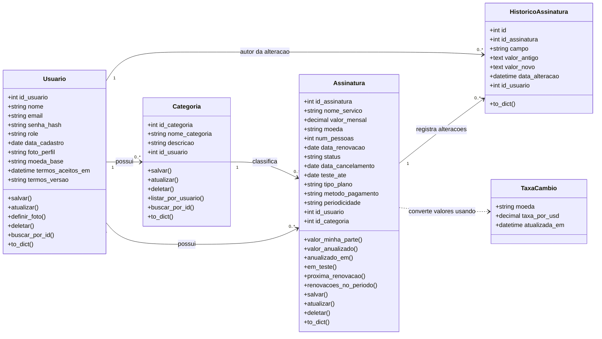

# Diagrama de classes do domínio

Classes de domínio do Assinify (as entidades SQLAlchemy em `backend/app/models/`) com seus atributos principais e relacionamentos.

## Relacionamentos

| Relação | Cardinalidade | Observação |
|---|---|---|
| `Usuario` possui `Categoria` | 1 para 0..* | Cascade `all, delete-orphan`: ao excluir o usuário, as categorias dele são apagadas. Cada usuário só enxerga as próprias. |
| `Usuario` possui `Assinatura` | 1 para 0..* | Cascade `all, delete-orphan`. |
| `Categoria` classifica `Assinatura` | 1 para 0..* | Uma categoria com assinaturas não pode ser excluída. |
| `Assinatura` registra `HistoricoAssinatura` | 1 para 0..* | Chave estrangeira com `ON DELETE SET NULL`: o histórico sobrevive à assinatura excluída. |
| `Usuario` é autor de `HistoricoAssinatura` | 1 para 0..* | Também `ON DELETE SET NULL`. |
| `Assinatura` usa `TaxaCambio` | dependência | Sem chave estrangeira: a taxa é buscada pela `moeda` (`app/cambio.py`) para converter o valor para a `moeda_base` do usuário. |
